# AI Job Search Monorepo  [](https://github.com/davidgfolch/AI-job-search/actions/workflows/ci.yml?branch=master)  [](https://github.com/davidgfolch/AI-job-search/actions/workflows/ci.yml?branch=staging)


> The `e2e` badge is the **frontend union** (web unit + e2e), the metric the 90% floor is
> enforced on; `web` is the unit run alone. See
> [Coverage Gates](READMEs/README_DEVELOPMENT.md#coverage-gates).

A comprehensive system to search, aggregate, and manage job offers from multiple platforms (LinkedIn, Infojobs, Glassdoor, etc.), enriched with AI job offer structured data extraction, skills/technologies description inference, etc.

## Project Structure

This is a monorepo containing several applications and packages:

| Component        | Path                                                 | Description                                               | Tech Stack                   |
| ---------------- | ---------------------------------------------------- | --------------------------------------------------------- | ---------------------------- |
| **Common Lib**   | [`apps/commonlib`](apps/commonlib/README.md)         | Shared Python utilities and database logic.               | Python, Poetry               |
| **Web UI**       | [`apps/web`](apps/web/README.md)                     | Modern React frontend for job management.                 | React, TypeScript, Vite, npm |
| **Backend API**  | [`apps/backend`](apps/backend/README.md)             | FastAPI backend serving the Web UI.                       | Python, FastAPI, uv          |
| **Cron**         | [`apps/cron`](apps/cron/README.md)                   | Background scheduler for periodic cron jobs.              | Python, uv, MongoDB          |
| **Scrapper**     | [`apps/scrapper`](apps/scrapper/README.md)           | Selenium + Scrapling job scrapers.                        | Python, Selenium, Poetry     |
| **AI Enrich**    | [`apps/aiEnrich`](apps/aiEnrich/README.md)           | AI enrichment using Ollama or OpenRouter                  | Python, Ollama/OpenRouter, uv |
| **AI Enrich Skill**| [`apps/aiEnrichSkill`](apps/aiEnrichSkill/README.md) | Local AI skill enrichment (Ollama & HuggingFace).        | Python, Transformers, uv     |
| **AI CV Matcher**| [`apps/aiCvMatcher`](apps/aiCvMatcher/README.md)     | Local fast CV matching.                                   | Python, SentenceTransformers |
| **AI Form Filler**| [`apps/aiFormFiller`](apps/aiFormFiller/README.md) | AI-powered form question answerer using CV + preferences. | Python, FastAPI, HuggingFace |

## Features

- Scrapping jobs from multiple platforms
- UI to manage job offers (& skills)
- AI enrichment of job offers (salary, skills, work modality)
- Deterministic salary scraping for the job boards that publish one (Indeed, Tecnoempleo), so the range is read from the offer instead of being left to the AI
- AI enrichment of skills
- AI enrichment of the company when a job board publishes the offer without one (stored as `unspecified` until inferred)
- AI CV matching
- AI Form Filler (browser extension + backend) to answer job application questions using your CV
- **Observability**: Structured logging + Prometheus metrics via `commonlib`; each app writes `data/logs/<app>.jsonl`, scraped by Prometheus (`:9090`) → Grafana (`:3000`, admin/admin); Prometheus text endpoint at `GET /api/metrics` (see [Metrics & Observability](READMEs/README_METRICS.md))
- **Settings UI** to manage `.env` / `.env.secrets` variables and scrapper state directly from the browser
- **Hot LLM provider switching**: change the aiEnrich, aiEnrichSkill and aiFormFiller providers and API keys in **Settings → LLM Providers**; workers apply them on their next job or request without a restart ([aiEnrich](apps/aiEnrich/README.md#llm-backend-selection), [aiEnrichSkill](apps/aiEnrichSkill/README.md#backends), [aiFormFiller](apps/aiFormFiller/README.md#ai-providers))
- **Seamless API Routing**: Frontend automatically routes API requests seamlessly depending on environment (Docker bridge vs native localhost) and supports access from remote devices natively.
- **Distributed execution & LAN service auto-discovery**: run the stack on one machine with Docker Compose (the default, no IPs to set), split services across machines, or keep the AI workers in Docker against an Ollama on the host or another LAN machine — MySQL/MongoDB, the backend, Ollama and the health probes are resolved automatically (see [Distributed execution & LAN service auto-discovery](READMEs/DISTRIBUTED_EXECUTION.md))

## CI / GitHub Automation

The CI pipeline, Dependabot version updates, and automatic merging of dependency PRs are documented in [GitHub Automation](READMEs/README_GITHUB.md). In short: CI only tests the modules affected by a change, Dependabot groups non-breaking updates per app, and green minor/patch Dependabot PRs auto-merge (majors stay manual; failing PRs never merge).

A separate `static-analysis` job is a **required check**: it lints every Python app with [Ruff](https://docs.astral.sh/ruff/), lints the frontend and the e2e suite with ESLint, and type-checks `apps/web` with `tsc`. Run the same checks locally with `./scripts/lint.sh` (see [Static Analysis](READMEs/README_DEVELOPMENT.md#static-analysis)).

## Screenshots

### UI Management

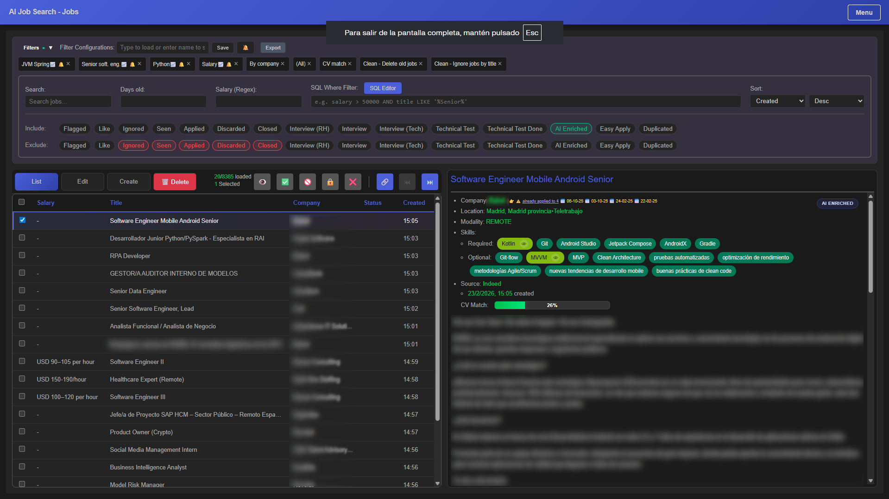

### AI daemons & fullstack app logs

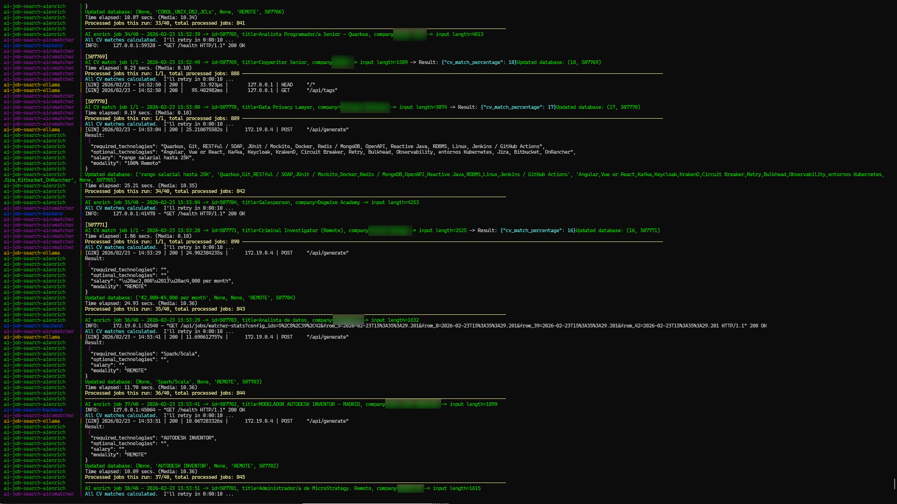

### Scrapper

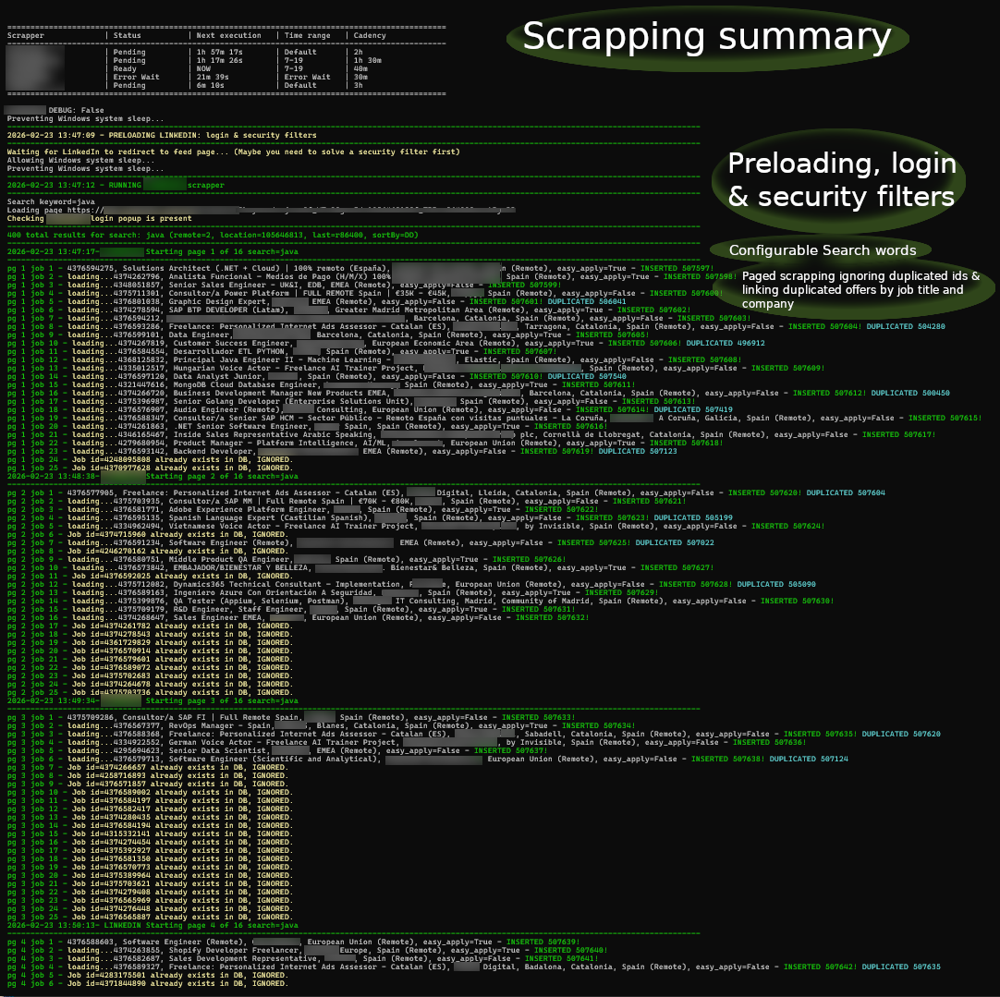

### Filters Configurations

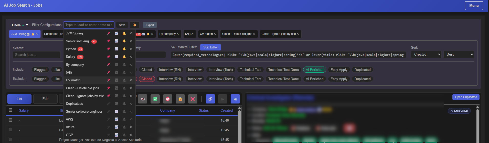

### Skills Manager

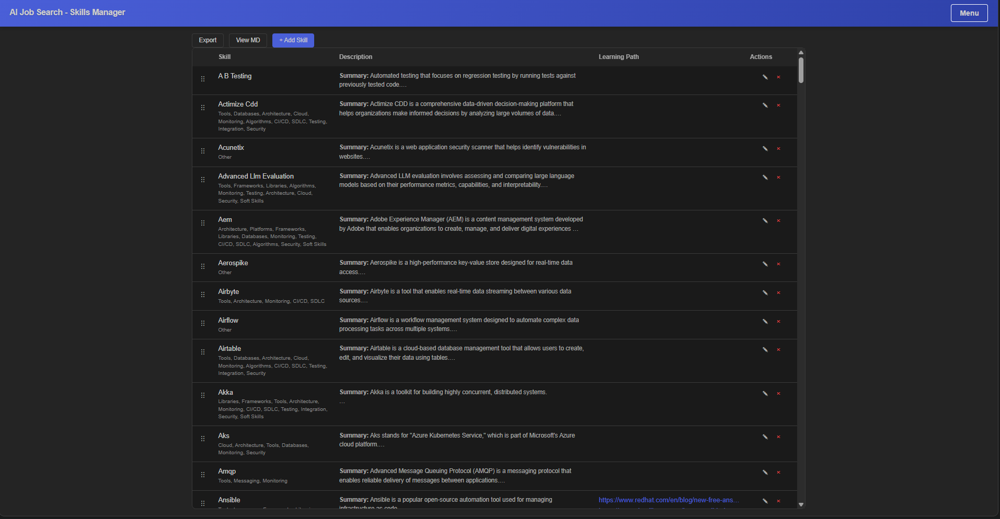

### Skills Edit

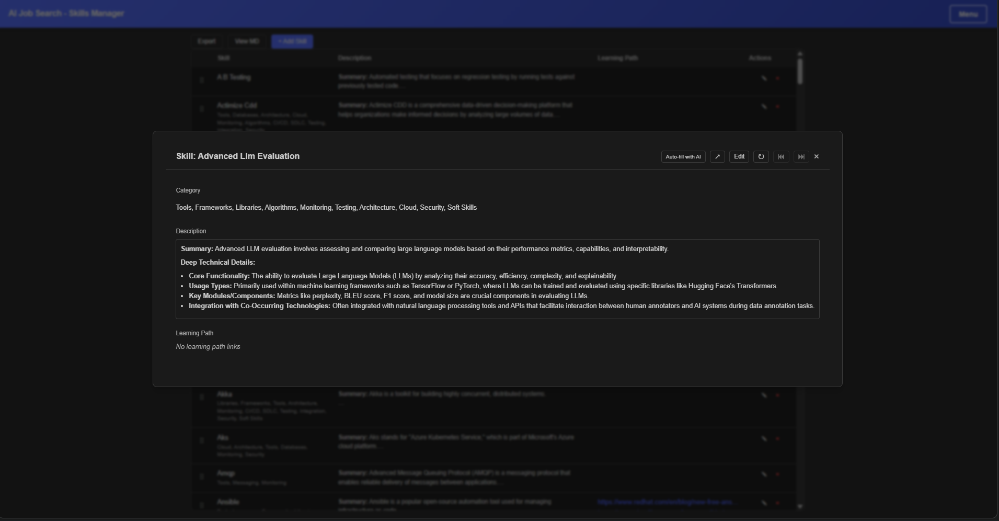

### Stats

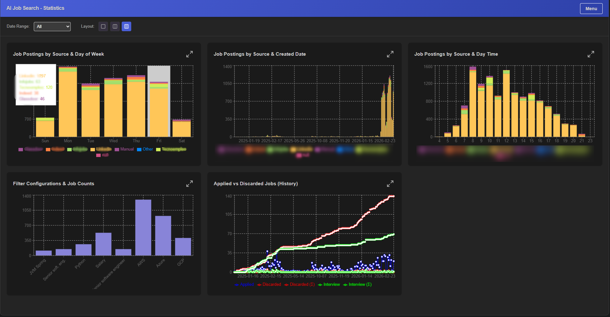

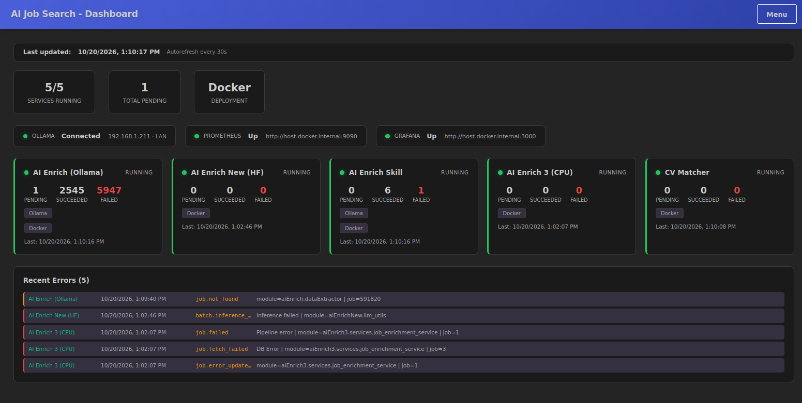

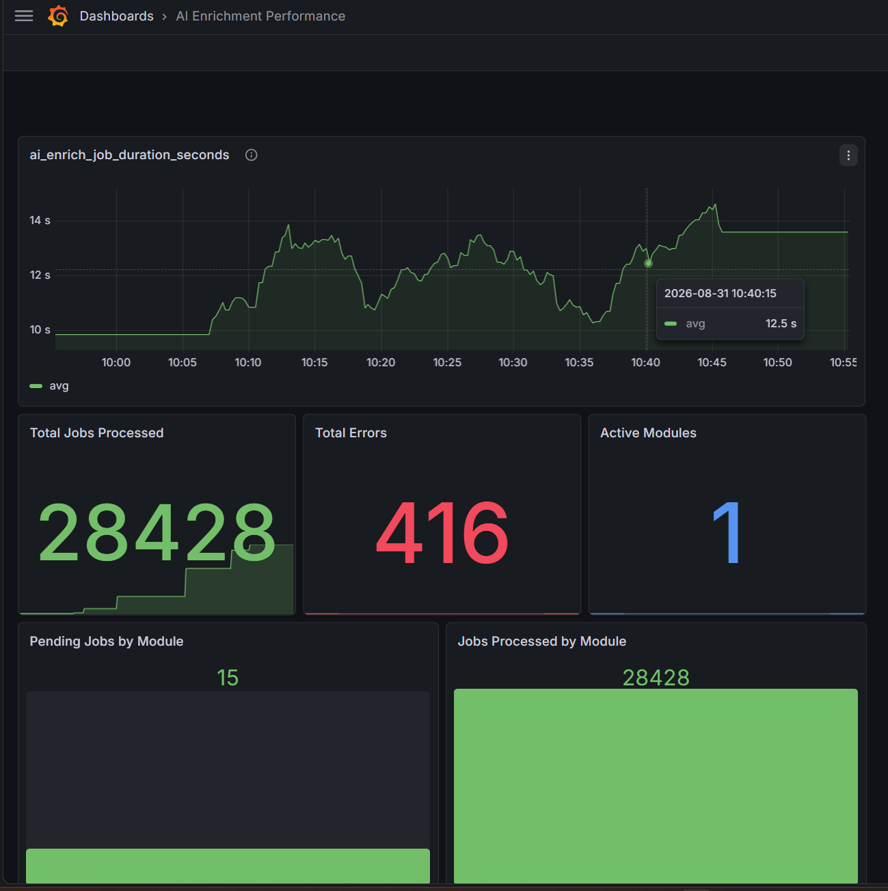

### Stats Filter Configurations

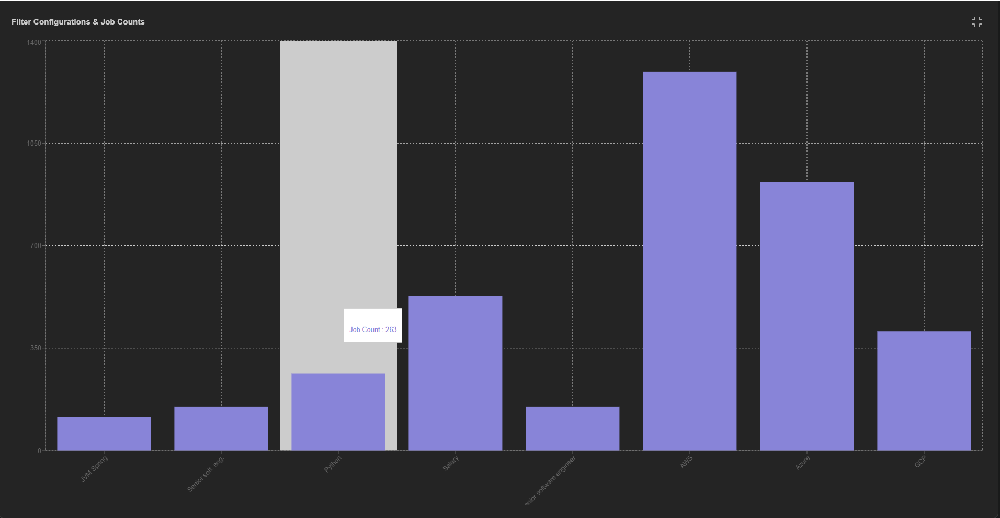

### Settings — Environment Variables

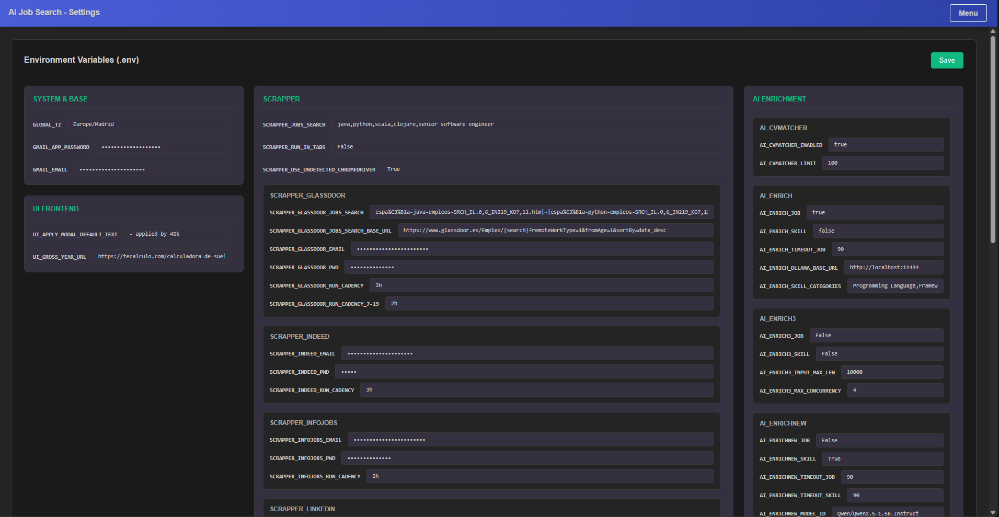

### Settings — Scrapper State

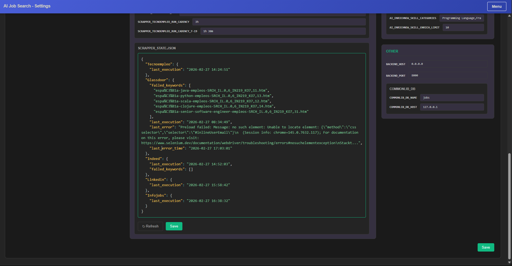

## Getting Started

### Docker Compose Profiles

The `docker-compose.yml` groups services into profiles: the core services start by default, and the AI services (`aienrich`, `aiEnrichSkill`) plus the opt-in `ollama` server are selected with `--profile`. The profile table, the exact commands and the service URLs live in [DOCKER_DEV.md](READMEs/DOCKER_DEV.md). Ollama can run on the host, in Docker or on another LAN machine, and the stack auto-discovers it; hosts are only pinned in `.env` when discovery cannot reach them — see [Distributed execution & LAN service auto-discovery](READMEs/DISTRIBUTED_EXECUTION.md).

The `web` service waits for the backend to answer before it serves, and reconnects to it when it moves, so it works with the backend containerized or running on the host (see [web backend discovery](apps/web/README.md#backend-discovery)).

### Install & run

Environment setup — Python/Node, host tools, dependencies, `.env` and `.env.secrets` — is documented once in [README_INSTALL.md](READMEs/README_INSTALL.md). After that:

```bash
docker-compose up -d      # core services
docker-compose logs -f

# in another terminal: the scrapper is not a Docker service
./apps/scrapper/run.sh    # or .\apps\scrapper\run.bat
```

Open the UI at [http://localhost:5173](http://localhost:5173). AI service profiles, the host-native runners and Docker troubleshooting: [DOCKER_DEV.md](READMEs/DOCKER_DEV.md#host-native-apps).

## Developer tooling

Cross-cutting developer concerns are documented once, in the reference guides under [`READMEs/`](READMEs/):

- **Testing** (centralized runner, when to run the suites): [README_DEVELOPMENT.md#testing](READMEs/README_DEVELOPMENT.md#testing)
- **Static analysis** (Ruff, ESLint, `tsc`, pre-commit): [README_DEVELOPMENT.md#static-analysis](READMEs/README_DEVELOPMENT.md#static-analysis)
- **Coverage gates** (frontend union, scrapper statements): [README_DEVELOPMENT.md#coverage-gates](READMEs/README_DEVELOPMENT.md#coverage-gates)
- **Structured logging** (events, conventions, `LOG_*` config): [README_DEVELOPMENT.md#structured-logging](READMEs/README_DEVELOPMENT.md#structured-logging)
- **CodeGraph** (code intelligence) and agent skills, rules and guardrails: [AGENTIC_SDLC.md](READMEs/AGENTIC_SDLC.md)

## Documentation

- **Installation**: [README_INSTALL.md](READMEs/README_INSTALL.md)
- **Development**: [README_DEVELOPMENT.md](READMEs/README_DEVELOPMENT.md)
- **Contributing**: [README_CONTRIBUTE.md](READMEs/README_CONTRIBUTE.md)
- **Docker**: [DOCKER_DEV.md](READMEs/DOCKER_DEV.md)
- **GitHub Automation (CI & Dependabot)**: [README_GITHUB.md](READMEs/README_GITHUB.md)
- **Metrics & Grafana**: [README_METRICS.md](READMEs/README_METRICS.md)
- **Agentic SDLC** (agents, CodeGraph, guardrails): [AGENTIC_SDLC.md](READMEs/AGENTIC_SDLC.md)
