# AI Job Search Monorepo  [](https://github.com/davidgfolch/AI-job-search/actions/workflows/ci.yml?branch=master)  [](https://github.com/davidgfolch/AI-job-search/actions/workflows/ci.yml?branch=staging)


> The `e2e` badge is the **frontend union** (web unit + e2e), the metric the 90% floor is
> enforced on; `web` is the unit run alone. See
> [Coverage Gates](READMEs/README_DEVELOPMENT.md#coverage-gates).

A comprehensive system to search, aggregate, and manage job offers from multiple platforms (LinkedIn, Infojobs, Glassdoor, etc.), enriched with AI job offer structured data extraction, skills/technologies description inference, etc.

## Project Structure

This is a monorepo containing several applications and packages:

| Component        | Path                                                 | Description                                               | Tech Stack                   |
| ---------------- | ---------------------------------------------------- | --------------------------------------------------------- | ---------------------------- |
| **Common Lib**   | [`apps/commonlib`](apps/commonlib/README.md)         | Shared Python utilities and database logic.               | Python, Poetry               |
| **Web UI**       | [`apps/web`](apps/web/README.md)                     | Modern React frontend for job management.                 | React, TypeScript, Vite, npm |
| **Backend API**  | [`apps/backend`](apps/backend/README.md)             | FastAPI backend serving the Web UI.                       | Python, FastAPI, Poetry      |
| **Cron**         | [`apps/cron`](apps/cron/README.md)                   | Background scheduler for periodic cron jobs.              | Python, uv, MongoDB          |
| **Scrapper**     | [`apps/scrapper`](apps/scrapper/README.md)           | Selenium-based job scrapers.                              | Python, Selenium, Poetry     |
| **AI Enrich**    | [`apps/aiEnrich`](apps/aiEnrich/README.md)           | AI enrichment using Ollama or OpenRouter                  | Python, Ollama/OpenRouter, uv |
| **AI Enrich Skill**| [`apps/aiEnrichSkill`](apps/aiEnrichSkill/README.md) | Local AI skill enrichment (Ollama & HuggingFace).        | Python, Transformers, uv     |
| **AI CV Matcher**| [`apps/aiCvMatcher`](apps/aiCvMatcher/README.md)     | Local fast CV matching.                                   | Python, SentenceTransformers |
| **AI Form Filler**| [`apps/aiFormFiller`](apps/aiFormFiller/README.md) | AI-powered form question answerer using CV + preferences. | Python, FastAPI, HuggingFace |

## Features

- Scrapping jobs from multiple platforms
- UI to manage job offers (& skills)
- AI enrichment of job offers (salary, skills, work modality)
- Deterministic salary scraping for the job boards that publish one (Indeed, Tecnoempleo), so the range is read from the offer instead of being left to the AI
- AI enrichment of skills
- AI enrichment of the company when a job board publishes the offer without one (stored as `unspecified` until inferred)
- AI CV matching
- AI Form Filler (browser extension + backend) to answer job application questions using your CV
- **Observability**: Structured logging + Prometheus metrics via `commonlib`; each app writes its own `data/logs/<app>.jsonl` (see [Structured Logging](READMEs/README_DEVELOPMENT.md#structured-logging)); scraped by Prometheus (`:9090`) → Grafana dashboard (`:3000`, admin/admin); JSON API at `GET /api/enrichment/metrics`
- **Dual console & log output**: a record can carry both its structured fields and the human line to print (`console=`, `end=""`), so the scrapper keeps its classic console transcript while `scrapper.jsonl` stays complete and queryable (see [Scrapper — Console Output](apps/scrapper/README.md#console-output--structured-logging)). Workers also use this for batch progress (`footer()` → `ai.batch_completed`) and for the wait between cycles (`logIdleWait()` → `jobs.skipped` / `ai.retry_wait`), so a container log still reads as a progress line instead of a field dump
- **Per-record attribution**: `module` is stamped from the calling app module and `job_id` from `job_log_context()`, so a record stays attributable to the worker and the job even when a shared helper logged it
- **Settings UI** to manage `.env` / `.env.secrets` variables and scrapper state directly from the browser
- **Seamless API Routing**: Frontend automatically routes API requests seamlessly depending on environment (Docker bridge vs native localhost) and supports access from remote devices natively.

## CI / GitHub Automation

The CI pipeline, Dependabot version updates, and automatic merging of dependency PRs are documented in [GitHub Automation](READMEs/README_GITHUB.md). In short: CI only tests the modules affected by a change, Dependabot groups non-breaking updates per app, and green minor/patch Dependabot PRs auto-merge (majors stay manual; failing PRs never merge).

A separate `static-analysis` job is a **required check**: it lints every Python app with [Ruff](https://docs.astral.sh/ruff/), lints the frontend and the e2e suite with ESLint, and type-checks `apps/web` with `tsc`. Run the same checks locally with `./scripts/lint.sh` (see [Static Analysis](READMEs/README_DEVELOPMENT.md#static-analysis)).

## Distributed execution

You can have specific mysql host server setting the `.env` ->  `COMMONLIB_DB_HOST` to your mysql database host IP.
You can run scrapper in a (linux recommended) & connect to another mysql host pc.

### Scrapper MySQL host auto-discovery

`COMMONLIB_DB_HOST` supports single IPs, CIDR, ranges, and comma-separated combinations, with automatic LAN fallback. See [commonlib docs](apps/commonlib/README.md#mysql-connection) for details.

### Web Backend API auto-discovery

The web app resolves the backend API when it starts and keeps watching it afterwards. It tries `http://backend:8000` → `http://host.docker.internal:8000` → `http://localhost:8000` inside Docker, and `http://localhost:8000` → `http://host.docker.internal:8000` → `http://backend:8000` on the host, so it works with the backend containerized or not. The dev server **waits** for the backend to answer before serving (bounded by `BACKEND_WAIT_TIMEOUT_SECONDS`, default 120), which is what makes a container start or a host reboot safe. A watchdog probes the current target every `BACKEND_CHECK_INTERVAL_SECONDS` (default 10) and, after `BACKEND_MAX_RETRIES` (default 3) consecutive failures, resolves the backend again and retargets the live proxy. Set `BACKEND_URL` to pin the target, `BACKEND_DISCOVERY=True` to allow the LAN scan as a last resort. See [web docs](apps/web/README.md#backend-discovery) for details.

Run only web in the client machine like this:

```bash
docker-compose up -d --no-deps web
```

### Ollama auto-discovery

The Ollama-backed modules resolve the server from a short probe against the configured URL (`.env` → `AI_ENRICH_OLLAMA_BASE_URL`, which the workers honour; `docker-compose.yml` only defaults to the containerized `ollama:11434` when it is unset) and the shared fallback chain. When none of them answers, the LAN is scanned for an Ollama server on port 11434 (`COMMONLIB_OLLAMA_DISCOVERY=False` disables the scan), so running Ollama on another machine on the LAN needs no extra configuration — the dashboard automatically scans the common LAN subnets (`192.168.0.x`, `192.168.1.x`) even when it runs inside a Docker container. Setting `AI_ENRICH_OLLAMA_BASE_URL=auto` goes straight to the scan. Before a job is sent, the chosen server must answer a one-token generation probe, so a wedged runner is skipped in seconds instead of blocking the full `AI_ENRICH_TIMEOUT_JOB` (tune with `COMMONLIB_OLLAMA_PROBE_TIMEOUT`, default 30s). If your LAN uses a different subnet, add it with `COMMONLIB_OLLAMA_DISCOVERY_SUBNETS` (comma-separated CIDRs, e.g. `10.0.0.0/24`). See [commonlib docs](apps/commonlib/README.md) for details.

### Watcher notifications

After enrichment, `aiEnrich` POSTs the enriched job IDs to the backend (`/api/jobs/notify-watcher`) so the watcher badge updates, through the shared `commonlib.watcher_notify` client. The backend URL is auto-discovered the same way as Ollama (`http://backend:8000` → `http://host.docker.internal:8000` → `http://localhost:8000`); set `AI_ENRICH_BACKEND_URL` in `.env` to pin it. The call is best-effort — an unreachable backend only logs `watcher.notify_failed`, a rejected one logs `watcher.notify_rejected`, and enrichment continues. See [aiEnrich docs](apps/aiEnrich/README.md#watcher-notification).

### Dashboard: Prometheus & Grafana health

The dashboard probes Prometheus and Grafana on every refresh (via `GET /-/healthy` and `GET /api/health`) and shows their status as **Up**/**Down** summary cards. The target URLs are configured with:

- `PROMETHEUS_URL` (default `http://host.docker.internal:9090` — works from the backend container via `extra_hosts: host.docker.internal=host-gateway`)
- `GRAFANA_URL` (default `http://host.docker.internal:3000`)

Override them in `.env` if your Prometheus/Grafana run on a different host or port.

So in another PC in the same LAN you can run services that depend on Ollama, it must be run outside docker:

```bash
./apps/aiEnrich/run.sh & ./apps/aiEnrichSkill/run.sh
```

## Screenshots

### UI Management

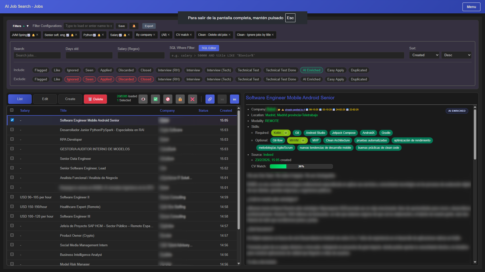

### AI daemons & fullstack app logs

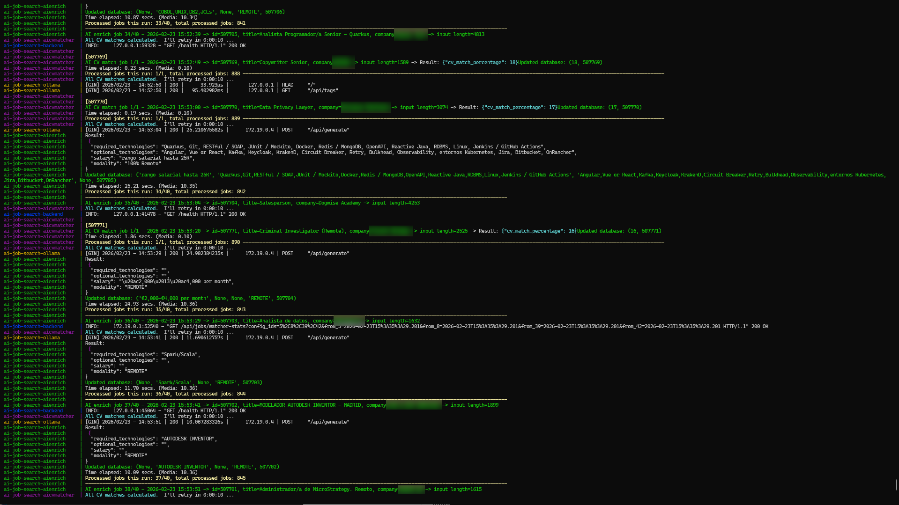

### Scrapper

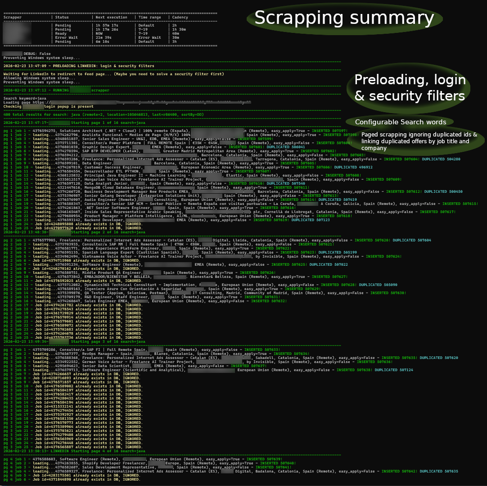

### Filters Configurations

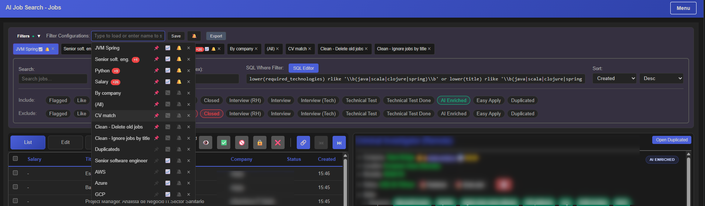

### Skills Manager

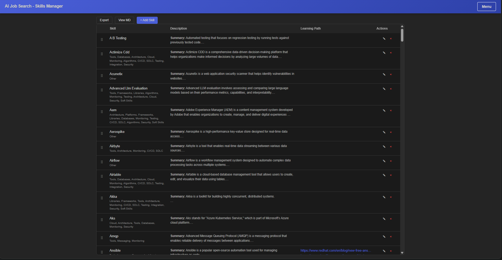

### Skills Edit

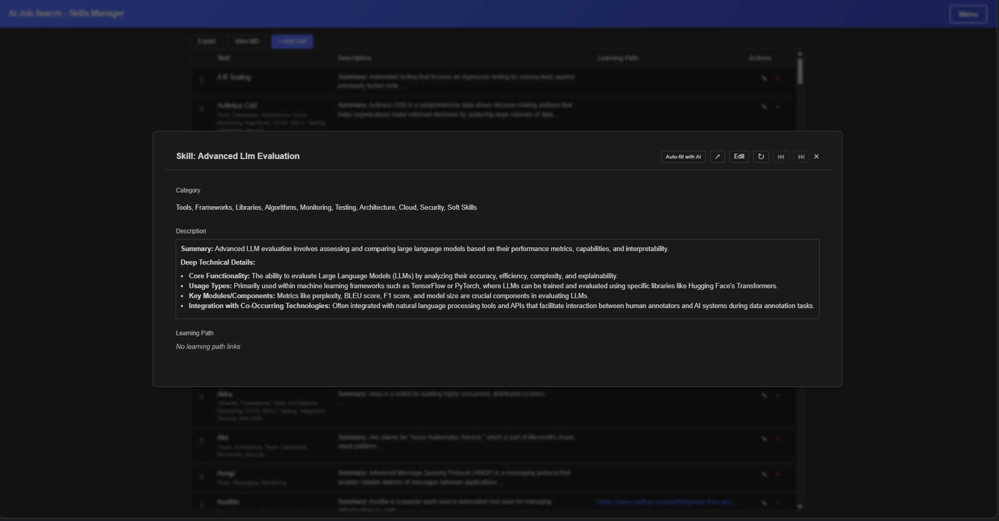

### Stats

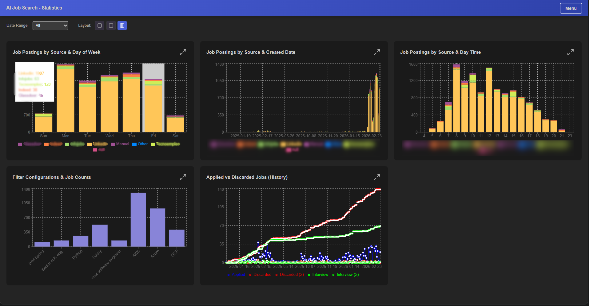

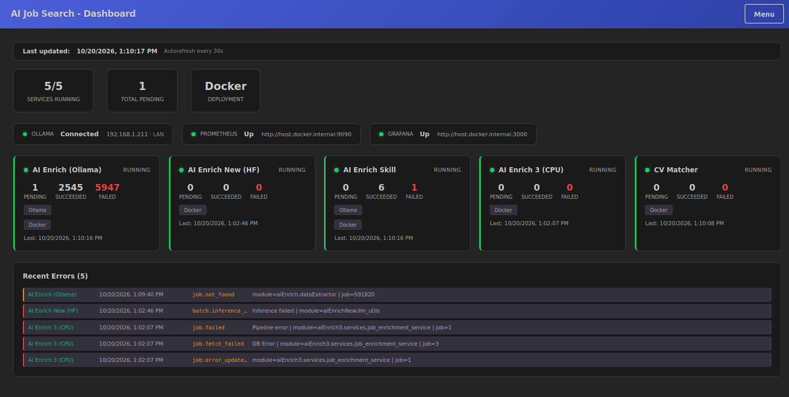

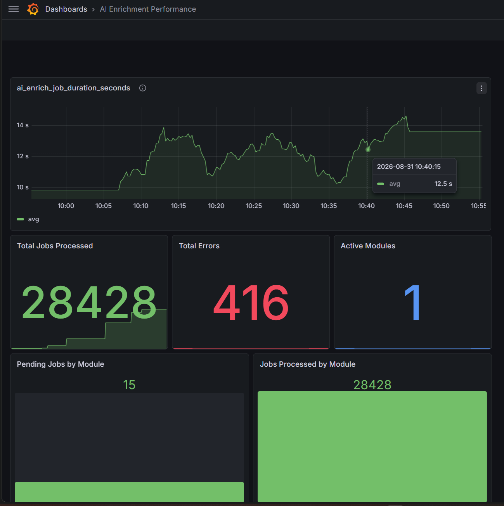

### Stats Filter Configurations

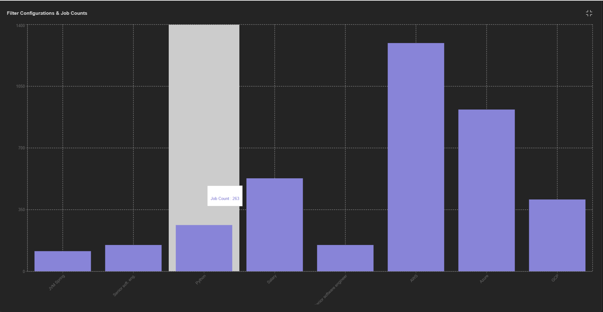

### Settings — Environment Variables

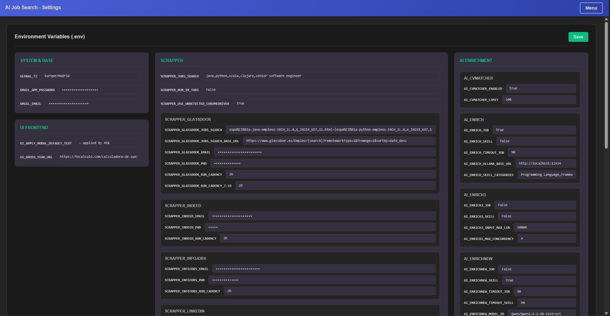

### Settings — Scrapper State

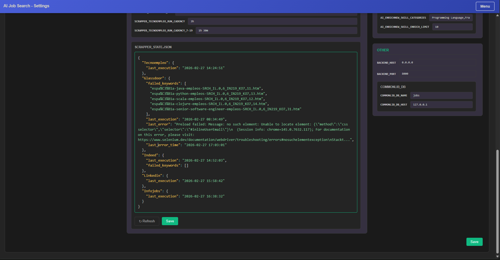

## Getting Started

### Docker Compose Profiles

The `docker-compose.yml` defines several service profiles to control which containers start:

| Profile        | Services                          | Description                      |
| -------------- | --------------------------------- | -------------------------------- |
| _(default)_    | `mysql_db`, `backend`, `web`, `aicvmatcher`, `aiformfiller`, `prometheus`, `grafana` | Unprofiled core services (always start) |
| `ollama`       | `ollama`                          | Containerized Ollama server (opt-in; see [Ollama: host vs container](#ollama-host-vs-container)) |
| `aienrich`     | `aienrich`                        | Ollama AI enrichment             |
| `aiEnrichSkill`| `aienrichskill`                   | AI skill enrichment (Ollama & HuggingFace) |

**Auto-started** (no `--profile` flag): `mysql_db`, `backend`, `web`, `aicvmatcher`, `aiformfiller`.
Use `--profile` to run the profile-gated AI enrichment services:

```bash
docker-compose --profile aienrich up -d aienrich
docker-compose --profile aiEnrichSkill up -d aienrichskill
```

The `web` service waits for the backend to answer before it serves, and reconnects to it when it moves, so it works with the backend containerized or running on the host (see [Web Backend API auto-discovery](#web-backend-api-auto-discovery)).

#### Ollama: host vs container

The `ollama` service is **opt-in** (`--profile ollama`), so the stack works whether Ollama runs on your host or in Docker. The Ollama-backed modules (`aienrich`, `aienrichskill`) auto-detect the server at startup: they probe the configured URL, then `host.docker.internal`, `localhost`, the containerized `ollama:11434` (`apps/commonlib/commonlib/ollama_config.py`), and finally the LAN on port 11434 (see [Ollama auto-discovery](#ollama-auto-discovery)). No module hard-depends on the `ollama` container, so it is never started implicitly.

```bash
# Ollama already installed on the host (nothing extra to start)
docker-compose --profile aienrich up -d aienrich

# Ollama containerized as well
docker-compose --profile ollama --profile aienrich up -d
```

The **scrapper** runs natively on the host as a batch job (not a Docker service, not long-running). Start it in a terminal:

```bash
./apps/scrapper/run.sh   # or .\apps\scrapper\run.bat on Windows
```

### Quick Start

- Copy `scripts/.env.secrets.example` to `.env.secrets` and set your credentials there.
- Set your options in `.env` (e.g., SCRAPPER_JOBS_SEARCH, CV_MATCH flag, etc.)
- Run dockerized applications `docker-compose up -d` (starts default services).
- Run `apps/scrapper/run.(bat/sh)` in terminal.
- Navigate to UI at [http://localhost:5173](http://localhost:5173)
- Run `aiEnrich` (Ollama by default, or OpenRouter with `AI_ENRICH_BACKEND=openrouter`) for AI enrichment:
  - Start it with `docker-compose --profile aienrich up -d aienrich`.
- Run `aiCvMatcher` (local fast CV matching):
  - It runs by default via `docker-compose up -d` if enabled. Make sure `AI_CVMATCHER_ENABLED=True` is in your `.env`.
- Run `aiFormFiller` (AI-powered form question answerer):
  - Auto-starts with Docker by default. Alternatively run manually with `.\apps\aiFormFiller\run.bat`.
  - Load the `apps/aiFormFiller/extension/` folder as an unpacked extension in Chrome.
  - Right-click any form field → "Answer with AI".

NOTE: the scrapper is not a Docker service; run it manually on the host (see below).

### Installation

Please see [README_INSTALL.md](READMEs/README_INSTALL.md) for detailed setup instructions.

### Run with Docker 🐳

You can run for development or just to use it.

```bash
docker-compose up -d
docker-compose logs -f
```

Then run the scrappers in a separate terminal:

```bash
./apps/scrapper/run.sh # or .bat
```

> **After changing web dependencies**, just rebuild and restart the web container:
> `docker-compose up -d --build web`. Its entrypoint auto-detects the changed
> `package-lock.json` and reinstalls `node_modules` on start.

See [DOCKER_DEV.md](READMEs/DOCKER_DEV.md).

## Run Manually (Using Helper Scripts)

Each application includes convenience scripts (`run.sh` / `run.bat`) to start them easily.

### Linux / macOS (`.sh`)

```bash
# 1. Database
./scripts/runMysql.sh

# 2. Scrappers
./apps/scrapper/run.sh

# 3. AI Enrichment
# (Using Ollama, default, or OpenRouter with AI_ENRICH_BACKEND=openrouter)
./apps/aiEnrich/run.sh
# (Local Fast CV Matcher)
./apps/aiCvMatcher/run.sh
# (AI Form Filler backend)
./apps/aiFormFiller/run.sh

# 4. New UI (Backend + Web)
./apps/backend/run.sh
./apps/web/run.sh
```

### Windows (`.bat`)

```cmd
:: 1. Database
docker compose up -d

:: 2. Scrappers
.\apps\scrapper\run.bat

:: 3. AI Enrichment
:: (Using Ollama, default, or OpenRouter with AI_ENRICH_BACKEND=openrouter)
.\apps\aiEnrich\run.bat
:: (Local Fast CV Matcher)
.\apps\aiCvMatcher\run.bat
:: (AI Form Filler backend)
.\apps\aiFormFiller\run.bat

:: 4. New UI (Backend + Web)
.\apps\backend\run.bat
.\apps\web\run.bat
```

## Code Intelligence (CodeGraph)

[CodeGraph](https://github.com/colbymchenry/codegraph) is the project's default code-intelligence tool. It builds a local index of the repository in `.codegraph/` (gitignored) and keeps it fresh through a background daemon. `scripts/install.sh` / `scripts/install.bat` install it, wire its MCP server into Claude Code and opencode, and build the initial index.

```bash
# Index status, incremental sync and full rebuild
codegraph status
codegraph sync
codegraph index

# Explore the codebase
codegraph explore "how does the scrapper scheduler dispatch platforms"
codegraph node ScrapperScheduler
codegraph impact ScrapperScheduler
codegraph affected apps/scrapper/scrapper/core/scrapper_scheduler.py
```

Agents use the `codegraph_explore` / `codegraph_node` MCP tools (or the CLI equivalents) before grepping or reading files. `.codegraph/` is machine-local generated state — never commit it; `codegraph uninit` removes the index and `codegraph uninstall --yes` removes the agent wiring and CLI. See the [CodeGraph skill](.claude/skills/codegraph/SKILL.md) for the full command list.

## Static Analysis

The whole monorepo is covered by one static-analysis gate, run locally and in CI through the same entry point:

```bash
# Everything: ruff + web eslint/tsc + e2e eslint
./scripts/lint.sh          # or .\scripts\lint.bat

# Per target
./scripts/lint.sh python   # ruff over apps/ and scripts/ (root ruff.toml)
./scripts/lint.sh web      # eslint + tsc -b over apps/web
./scripts/lint.sh e2e      # eslint over apps/e2e
```

| Target | Tool | Rules in force |
|--------|------|----------------|
| Python | [Ruff](https://docs.astral.sh/ruff/) (installed once with `uv tool install ruff`) | `E9`, `F401` unused imports, `F841` unused variables, `F811` dead redefinitions, `ARG` unused arguments and the whole [flake8-bugbear](https://github.com/PyCQA/flake8-bugbear) set (`B`) |
| Web | ESLint + `tsc -b` | unused code and explicit `any` are errors; the React Compiler advisory hooks rules are warnings |
| E2E | ESLint | unused code is an error; explicit `any` is a warning |

Ruff is configured once for the whole repo in the root [`ruff.toml`](ruff.toml); the apps keep their own package managers and need no linter dependency. The ESLint policies live in [`apps/web/eslint.config.js`](apps/web/eslint.config.js) and [`apps/e2e/eslint.config.mjs`](apps/e2e/eslint.config.mjs).

Details: [Static Analysis](READMEs/README_DEVELOPMENT.md#static-analysis).

## Documentation

- **Installation**: [README_INSTALL.md](READMEs/README_INSTALL.md)
- **Development**: [README_DEVELOPMENT.md](READMEs/README_DEVELOPMENT.md)
- **Contributing**: [README_CONTRIBUTE.md](READMEs/README_CONTRIBUTE.md)
- **Docker**: [DOCKER_DEV.md](READMEs/DOCKER_DEV.md)
- **GitHub Automation (CI & Dependabot)**: [README_GITHUB.md](READMEs/README_GITHUB.md)
- **Metrics & Grafana**: [README_METRICS.md](READMEs/README_METRICS.md)
- **Structured Logging** (events, conventions, `LOG_*` config): [README_DEVELOPMENT.md#structured-logging](READMEs/README_DEVELOPMENT.md#structured-logging)
